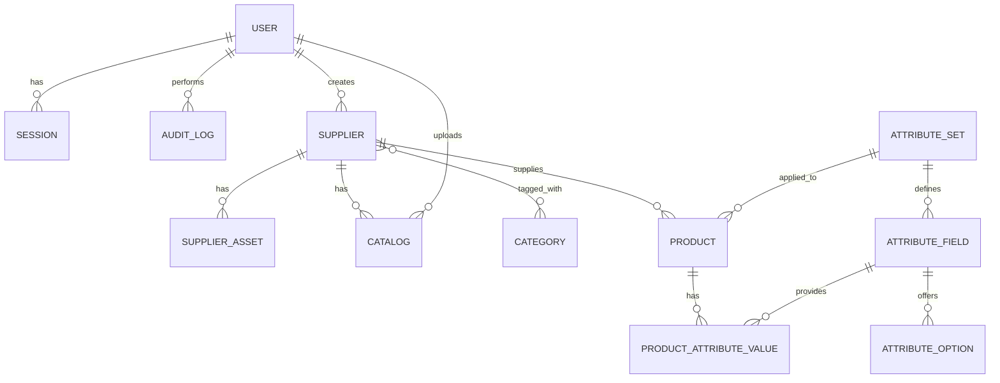

# Supplier & Product Management Application – Specification

| Field | Value |
|---|---|
| Version | 0.2 |
| Status | Confirmed – ready for implementation |
| Date | 2026-10-31 |

---

## 1. Overview

A web application that lets authenticated users manage **suppliers**, the **assets** attached to them (such as PDF catalogs), the **products** each supplier provides, and **attribute sets** that define custom product attributes.

### 1.1 Goals

- Secure login for users.
- Create and maintain suppliers with a name, an address, and directly assigned categories; supplier category summaries also include product categories.
- Attach supporting files of any type to each supplier.
- Link products to suppliers with a name, supplier SKU, minimum quantity, and cost.
- Define reusable **attribute sets** (for example, "MDF Panel" or "Paint") containing custom fields, and apply them to products.
- Provide a data model and API that support searching suppliers by category in a future release.

### 1.2 Non-Goals (this release)

- Category search UI (the backend filter is included; the UI is deferred).
- Purchase orders, inventory levels, or pricing history.
- Multi-tenant (organization-level) separation.
- Supplier self-service portal.
- Import/export of spreadsheets (may be added later).

### 1.3 Terminology

| Term | Definition |
|---|---|
| Supplier | An organization that provides products. Previously referred to as "vendor". |
| Category | A label applied directly to suppliers or products. Supplier category summaries also include categories inherited from their products. |
| Asset | A file of any type attached to a supplier. |
| Catalog | A named, versioned PDF price or product catalog attached to a supplier. A catalog is a separate entity from an asset. |
| Product | An item provided by a supplier. |
| Supplier SKU | The supplier's own identifier for a product. Unique per supplier. |
| Attribute Set | A named template containing attribute fields. |
| Attribute Field | A single typed property within an attribute set (for example, Width). |
| Attribute Value | The value of an attribute field for a specific product. |

---

## 2. Decisions

| # | Topic | Decision |
|---|---|---|
| D1 | User roles | Two roles: `admin` and `standard`. Standard users are read-only. Admins have full write access and manage users. |
| D2 | Registration | No self-registration. Admins create accounts and reset passwords. |
| D3 | First admin | Created by a command-line seed script that takes an email and password. |
| D4 | Currency | Each product has its own currency, any valid ISO 4217 code. |
| D5 | Stack | TypeScript end-to-end: React with Vite (frontend), Node.js with Fastify (backend), PostgreSQL with Prisma. |
| D6 | UI components | All React UI components must come from shadcn/ui (https://ui.shadcn.com), built on Radix UI and Tailwind CSS. Untitled UI and Ark UI are no longer used. |
| D7 | Hosting | Local or on-premises only for now. |
| D8 | Units | Attribute fields may specify a unit (for example `mm`), stored as metadata only. |
| D9 | Audit log | Every action is logged (see §4.10). Viewable by admins only, retained indefinitely. |
| D10 | Locales | English (`en`) and French (`fr`) are the supported locales for translatable data. Each translatable field is stored as one column per locale (see section 5). |
| D11 | Creation UX | Creating a category, attribute set, product, or supplier opens a modal dialog, the same pattern as creating a catalog. List pages do not use inline text inputs for creation. |

---

## 3. Actors

| Actor | Description |
|---|---|
| Standard User | Logged-in user with read-only access to all data. |
| Admin | Logged-in user with full read/write access, user management, and audit log access. |
| Anonymous Visitor | Can only access the login page. |

---

## 4. Functional Requirements

### 4.1 Authentication (FR-AUTH)

| ID | Requirement |
|---|---|
| FR-AUTH-01 | The system shall allow a user to log in with email and password. |
| FR-AUTH-02 | Passwords shall be stored only as hashes (bcrypt or argon2). |
| FR-AUTH-03 | Successful login shall create a session identified by an `httpOnly`, `Secure` (in production), `SameSite=Lax` cookie. |
| FR-AUTH-04 | The user shall be able to log out, which invalidates the session. |
| FR-AUTH-05 | All routes except the login page and health check shall require an authenticated session. |
| FR-AUTH-06 | Login attempts shall be rate-limited per IP and per account. |
| FR-AUTH-07 | Generic error messages shall be returned for failed logins (no user-enumeration). |
| FR-AUTH-08 | A command-line seed script shall create the first admin account from an email and password. |
| FR-AUTH-09 | Sessions shall expire after a configurable period of inactivity (default 8 hours). |

### 4.2 Suppliers (FR-SUP)

| ID | Requirement |
|---|---|
| FR-SUP-01 | The user shall be able to create a supplier with: **name** (required, 1–200 chars), **address** (street, city, state/region, postal code, country), and zero or more directly assigned **categories**. |
| FR-SUP-02 | The user shall be able to view a list of suppliers with pagination (default 25 per page). |
| FR-SUP-03 | The user shall be able to view a single supplier's details. |
| FR-SUP-04 | The user shall be able to edit a supplier's name, address, and categories. |
| FR-SUP-05 | An admin shall be able to delete a supplier. Deletion is blocked if the supplier has products (see §8.3). |
| FR-SUP-06 | The supplier list shall support filtering by free-text name match. |
| FR-SUP-07 | The API shall support filtering suppliers by one or more categories (`GET /suppliers?category=<id>`) to enable future search. |
| FR-SUP-08 | Supplier name shall be unique (case-insensitive) to prevent accidental duplicates. |
| FR-SUP-09 | Supplier creation shall open a modal dialog (FR-MODAL-01). The categories editor and asset upload remain available inside the dialog. Supplier name and address are not translated. |
| FR-SUP-10 | After a supplier is created from the dialog, the app shall navigate to the supplier detail page. |
| FR-SUP-11 | Supplier category summaries and category filters shall include the union of directly assigned categories and categories assigned to the supplier's products. Editing a supplier changes only its directly assigned categories. |

### 4.3 Categories (FR-CAT)

| ID | Requirement |
|---|---|
| FR-CAT-01 | The user shall be able to create a category with an English name that is unique (case-insensitive) and a French name (see FR-I18N-02). |
| FR-CAT-02 | The user shall be able to list all categories. |
| FR-CAT-03 | The user shall be able to rename a category. |
| FR-CAT-04 | The user shall be able to delete a category. Deleting it removes associations from suppliers, products and catalogs but does not delete those records. |
| FR-CAT-05 | Suppliers, products and catalogs may each have any number of categories; categories may be shared. |
| FR-CAT-06 | Categories may be created inline while assigning them to a supplier, product or catalog. |

### 4.4 Supplier Assets (FR-AST)

| ID | Requirement |
|---|---|
| FR-AST-01 | The user shall be able to upload files of any type to a supplier, including text, CSV, spreadsheets, documents, PDFs and images. |
| FR-AST-02 | Asset downloads shall use a safe attachment disposition and the stored, syntactically valid MIME type, with `nosniff`. Client-supplied types are not proof of content. |
| FR-AST-03 | Maximum file size shall be configurable (default 25 MB). |
| FR-AST-04 | Stored file names shall be generated (UUID-based); the original name is kept as metadata and sanitized. |
| FR-AST-05 | The user shall be able to list a supplier's assets with name, size, uploader name and ID, and upload date and time. The uploader identity is saved at upload; when no name is available, the user's email is used. Older assets with no recoverable identity show an unknown uploader. |
| FR-AST-06 | The user shall be able to download an asset. |
| FR-AST-07 | The user shall be able to delete an asset (file and metadata). |
| FR-AST-08 | Files shall be stored outside the publicly served directory. |
| FR-AST-09 | Storage shall be accessed through an interface so the backing store (local disk or S3) can be swapped. New assets and catalogs use separate `assets/` and `catalogs/` prefixes; legacy keys remain accessible. |
| FR-AST-10 | Optional: the user may give an asset a display title and a short description. |

### 4.4A Supplier Catalogs (FR-CLG)

| ID | Requirement |
|---|---|
| FR-CLG-01 | The user shall be able to upload a catalog with or without a supplier and assign, change or remove its supplier later. A catalog is a PDF file with a required **name** (1–200 chars) and an optional **version** (1–50 chars). |
| FR-CLG-02 | Catalog uploads shall be PDF only, validated by MIME type and `%PDF-` signature, and follow FR-AST-03 and FR-AST-04. |
| FR-CLG-03 | The catalog's **weight** is its file size in bytes. It is computed at upload and is read-only. |
| FR-CLG-04 | The user shall be able to list a supplier's catalogs with name, version, weight, and last updated date. |
| FR-CLG-05 | The user shall be able to download a catalog. |
| FR-CLG-06 | An admin may edit a catalog's name, version, supplier and categories. **Last updated** is set automatically to the time of the most recent change. |
| FR-CLG-07 | The user shall be able to delete a catalog (file and metadata). |
| FR-CLG-08 | When catalog analysis is enabled, an uploaded catalog PDF shall be queued for asynchronous analysis. When disabled (the default), uploads remain available and their status is `not_processed`. Each catalog shall expose `not_processed`, `queued`, `processing`, `processed`, or `failed` status, plus job progress and errors. |
| FR-CLG-09 | Analysis shall extract selectable PDF text before using OCR, and use English/French OCR for scanned pages. It shall identify product candidates and labeled attributes when recognizable, preserving source page references and excerpts. |
| FR-CLG-10 | Extracted products and suggested attribute fields shall remain review candidates; analysis shall not create products or attribute sets automatically. An admin may review candidates, create products from selected candidates, create an attribute set from suggested fields, and retry a failed or completed analysis. |
| FR-CLG-11 | Catalogs have independent categories. Assigning a supplier or adding catalog categories merges those categories into the supplier's direct categories without duplicates. Existing supplier categories remain, including after catalog unassignment, reassignment, category removal, or deletion. |

### 4.5 Attribute Sets (FR-ATS)

| ID | Requirement |
|---|---|
| FR-ATS-01 | The user shall be able to create an attribute set with an English name that is unique (case-insensitive) and a French name (see FR-I18N-02). |
| FR-ATS-02 | The user shall be able to list, view, rename, and delete attribute sets. |
| FR-ATS-03 | The user shall be able to add fields to an attribute set. |
| FR-ATS-04 | Each field shall have: **name** (required), **code** (auto-generated, unique within the set), **data type** (required), **unit** (optional), **required** flag, **options** (for select type), and **sort order**. |
| FR-ATS-05 | Supported data types: `text`, `number` (integer), `decimal`, `boolean`, `date`, `select` (single choice from a defined option list). |
| FR-ATS-06 | The user shall be able to edit a field's name, unit, required flag, options, and sort order. |
| FR-ATS-07 | Changing a field's data type is not allowed once products have values for it. |
| FR-ATS-08 | The user shall be able to reorder fields. |
| FR-ATS-09 | Fields in use by products shall be **archived**, not hard-deleted. Archived fields are hidden from forms but their values are preserved. |
| FR-ATS-10 | An attribute set may be deleted only if no products reference it. |

**Example attribute sets (seed data):**

| Attribute Set | Field | Type | Unit | Required |
|---|---|---|---|---|
| MDF Panel | Width | number | mm | Yes |
| MDF Panel | Length | number | mm | Yes |
| MDF Panel | Thickness | number | mm | Yes |
| Paint | Color | text | – | Yes |
| Paint | Texture | select (matte, satin, gloss) | – | No |
| Paint | Finish | text | – | No |

### 4.6 Products (FR-PRD)

| ID | Requirement |
|---|---|
| FR-PRD-01 | The user shall be able to create a product linked to exactly one supplier. |
| FR-PRD-02 | A product shall have: **name** (English and French, both required, 1–200 chars), **supplier SKU** (required), **minimum quantity** (integer ≥ 0, required), **cost** (decimal ≥ 0, up to 2 decimal places, required), and **currency** (any valid ISO 4217 code, required). |
| FR-PRD-03 | Supplier SKU shall be unique per supplier (case-insensitive). The same SKU may exist under different suppliers. |
| FR-PRD-04 | A product may optionally be assigned one attribute set. |
| FR-PRD-05 | When an attribute set is assigned, the product form shall render that set's fields and validate values against their types, units, and required flags. |
| FR-PRD-06 | Attribute values shall be stored per product and per field. |
| FR-PRD-07 | The user shall be able to edit a product, including changing its attribute set. Changing the set requires confirmation; values for fields not in the new set are removed. |
| FR-PRD-08 | The user shall be able to delete a product. |
| FR-PRD-09 | Products shall be listed on the supplier detail page and in a global product list with pagination and filtering by supplier and name/SKU. |
| FR-PRD-10 | A product may have an optional **description** in English and French, each up to 2000 characters. |
| FR-PRD-11 | The product create and edit forms shall include the name and description fields in both locales. The product detail view shows the description in the active language, falling back to English. |
| FR-PRD-10 | Products shall display their cost with the product's own currency. |
| FR-PRD-12 | A product may have zero or more categories. Product create/edit forms shall allow admins to assign categories; supplier category summaries inherit the categories of their products (FR-SUP-11). |

### 4.7 Supplier Detail View (FR-UI)

| ID | Requirement |
|---|---|
| FR-UI-01 | The supplier detail page shall have tabs: **Details**, **Categories**, **Assets**, **Catalogs**, **Products**. |
| FR-UI-02 | The attribute set builder shall support drag-and-drop reordering of fields. |
| FR-UI-03 | Forms shall display inline validation errors. |
| FR-UI-04 | Destructive actions (delete supplier, delete product, delete asset, change attribute set) shall require confirmation. |
| FR-UI-05 | All UI components in the React app shall come from shadcn/ui (https://ui.shadcn.com). |

---

### 4.8 Roles and Permissions (FR-ROL)

| ID | Requirement |
|---|---|
| FR-ROL-01 | Every user shall have exactly one role: `admin` or `standard`. |
| FR-ROL-02 | Standard users shall be able to view all suppliers, categories, assets (including download), products, and attribute sets. |
| FR-ROL-03 | Standard users shall not be able to create, edit, or delete any data. |
| FR-ROL-04 | Admins shall have full create, edit, and delete access to all data, and shall manage user accounts. |
| FR-ROL-05 | Role checks shall be enforced on the server for every endpoint, not only in the UI. |
| FR-ROL-06 | Standard users shall not see the audit log or user management screens. |

Where other requirements say "the user", they apply to admins only. Standard users are read-only per this section.

**Permissions matrix**

| Capability | Standard | Admin |
|---|---|---|
| View suppliers, categories, products, attribute sets, assets, catalogs | Yes | Yes |
| Download assets and catalogs | Yes | Yes |
| Create or edit suppliers, categories, assets, catalogs, products, attribute sets | No | Yes |
| Delete suppliers, categories, assets, catalogs, products, attribute sets | No | Yes |
| Manage user accounts and reset passwords | No | Yes |
| View audit log | No | Yes |

---

### 4.9 User Management (FR-USR)

| ID | Requirement |
|---|---|
| FR-USR-01 | Admins shall be able to create a user with email, display name, role, and an initial password. |
| FR-USR-02 | Admins shall be able to change a user's role and display name. |
| FR-USR-03 | Admins shall be able to reset any user's password. The user shall be required to change it at next login. |
| FR-USR-04 | Admins shall be able to deactivate and reactivate a user. Deactivated users cannot log in, and their sessions are revoked. |
| FR-USR-05 | Users shall be able to change their own password. |
| FR-USR-06 | The last active admin shall not be deactivated or demoted. |
| FR-USR-07 | Users shall be able to view their own profile. |

---

### 4.10 Audit Log (FR-AUD)

| ID | Requirement |
|---|---|
| FR-AUD-01 | Every user action shall be recorded: login success and failure, logout, create, update, delete, record view, list view, asset download, catalog download, and user management actions. |
| FR-AUD-02 | Each entry shall record: actor (user ID and email at the time), action, entity type, entity ID, outcome, UTC timestamp, IP address, and request ID. |
| FR-AUD-03 | Changes shall record before and after values for each changed field. Password hashes, tokens, and file contents shall never be recorded. |
| FR-AUD-04 | Failed login entries shall record the attempted email. No password shall be recorded. |
| FR-AUD-05 | Audit entries shall be append-only. No API or UI shall update or delete them. |
| FR-AUD-06 | Only admins shall be able to view the audit log. |
| FR-AUD-07 | The audit log UI shall support filtering by user, action, date range, and entity, with pagination. |
| FR-AUD-08 | Audit entries shall be retained indefinitely. |
| FR-AUD-09 | For actions that modify data, the audit entry shall be written in the same transaction as the change. |

---

### 4.11 Translations (FR-I18N)

| ID | Requirement |
|---|---|
| FR-I18N-01 | A translatable field has two values: `en` and `fr`. For categories, attribute sets, attribute fields, and products, the name is required in both locales. |
| FR-I18N-02 | On create, the `fr` value defaults to the `en` value. The server applies the same rule if `fr` is omitted, so `fr` is never empty. |
| FR-I18N-03 | In create and edit dialogs, the `fr` input is pre-filled from `en` until the user edits `fr` manually. After that, the two inputs are no longer linked. |
| FR-I18N-04 | Rename dialogs show both `en` and `fr` inputs side by side. |
| FR-I18N-05 | Lists, filter chips, and detail views display the name in the active UI language, falling back to `en` when the active value is empty. |
| FR-I18N-06 | Search matches text in either locale, case-insensitively. |
| FR-I18N-07 | Name uniqueness (case-insensitive) applies to the `en` value only, for categories and attribute sets. Attribute field names are unique within a set on the `en` value. |
| FR-I18N-08 | Audit entries for renames record before and after values for both `en` and `fr`. |
| FR-I18N-09 | Attribute option labels follow the same rules as attribute field names. Supplier name and address are not translated. |

### 4.12 Creation Dialogs (FR-MODAL)

| ID | Requirement |
|---|---|
| FR-MODAL-01 | Creating a category, attribute set, product, or supplier shall open a shadcn `Dialog` with a title, a description, a form body, and a footer with Cancel and Save. This matches the catalog upload dialog. |
| FR-MODAL-02 | List page headers keep a single primary button that opens the dialog. Inline text inputs for creation are removed from the category and attribute set pages. |
| FR-MODAL-03 | Validation errors are shown in an error alert inside the dialog, and field errors are shown under the field. The dialog stays open on error. |
| FR-MODAL-04 | Save is disabled while the request is in flight. On success the dialog closes and the list reloads. |
| FR-MODAL-05 | Escape and the close button dismiss the dialog without saving. |
| FR-MODAL-06 | Rename uses the same dialog component as create, with fields pre-filled. |
| FR-MODAL-07 | Only admins see create entry points (existing role rule). |

---

## 5. Data Model

### 5.1 Entity Definitions

**User**

| Column | Type | Constraints |
|---|---|---|
| id | UUID | PK |
| email | varchar(254) | Unique, not null, stored lowercase |
| password_hash | varchar(255) | Not null |
| display_name | varchar(100) | Nullable |
| role | enum | `admin` or `standard`, not null |
| is_active | boolean | Not null, default true |
| must_change_password | boolean | Not null, default false |
| last_login_at | timestamptz | Nullable |
| created_at | timestamptz | Not null |
| updated_at | timestamptz | Not null |

**Session**

| Column | Type | Constraints |
|---|---|---|
| id | UUID | PK |
| user_id | UUID | FK → User, not null |
| expires_at | timestamptz | Not null |
| created_at | timestamptz | Not null |

**Supplier**

| Column | Type | Constraints |
|---|---|---|
| id | UUID | PK |
| name | varchar(200) | Not null, unique (case-insensitive index) |
| street | varchar(200) | Nullable |
| city | varchar(100) | Nullable |
| state_region | varchar(100) | Nullable |
| postal_code | varchar(20) | Nullable |
| country | varchar(100) | Nullable |
| created_by | UUID | FK → User |
| created_at | timestamptz | Not null |
| updated_at | timestamptz | Not null |

**Category**

| Column | Type | Constraints |
|---|---|---|
| id | UUID | PK |
| name | varchar(100) | Not null, unique (case-insensitive index) |
| created_at | timestamptz | Not null |

**SupplierCategory** (join table)

| Column | Type | Constraints |
|---|---|---|
| supplier_id | UUID | FK → Supplier, on delete cascade |
| category_id | UUID | FK → Category, on delete cascade |
| | | PK (supplier_id, category_id) |

**SupplierAsset**

| Column | Type | Constraints |
|---|---|---|
| id | UUID | PK |
| supplier_id | UUID | FK → Supplier, on delete cascade |
| original_file_name | varchar(255) | Not null |
| storage_key | varchar(255) | Not null, unique |
| mime_type | varchar(100) | Not null |
| size_bytes | bigint | Not null |
| title | varchar(200) | Nullable |
| description | text | Nullable |
| uploaded_by_id | UUID | Nullable FK → User, on delete set null |
| uploader_id | UUID | Nullable uploader ID snapshot |
| uploader_name | varchar(254) | Nullable uploader display-name or email snapshot |
| created_at | timestamptz | Not null |

**Catalog**

| Column | Type | Constraints |
|---|---|---|
| id | UUID | PK |
| supplier_id | UUID | FK → Supplier, nullable; on delete set null |
| name | varchar(200) | Not null |
| version | varchar(50) | Nullable (optional since FR-CLG-01 was relaxed) |
| original_file_name | varchar(255) | Not null |
| storage_key | varchar(255) | Not null, unique |
| mime_type | varchar(100) | Not null |
| size_bytes | bigint | Not null (the catalog's weight, FR-CLG-03) |
| uploaded_by | UUID | FK → User |
| created_at | timestamptz | Not null |
| updated_at | timestamptz | Not null (last updated, FR-CLG-06) |

**CatalogCategory** links a catalog and a category with a composite primary key;
both foreign keys cascade on deletion.

**AttributeSet**

| Column | Type | Constraints |
|---|---|---|
| id | UUID | PK |
| name | varchar(100) | Not null, unique (case-insensitive) |
| created_at | timestamptz | Not null |
| updated_at | timestamptz | Not null |

**AttributeField**

| Column | Type | Constraints |
|---|---|---|
| id | UUID | PK |
| attribute_set_id | UUID | FK → AttributeSet, on delete restrict |
| name | varchar(100) | Not null |
| code | varchar(100) | Not null, unique within set |
| data_type | enum | `text`, `number`, `decimal`, `boolean`, `date`, `select` |
| unit | varchar(20) | Nullable |
| is_required | boolean | Not null, default false |
| is_archived | boolean | Not null, default false |
| sort_order | int | Not null |

**AttributeOption** (for `select` fields)

| Column | Type | Constraints |
|---|---|---|
| id | UUID | PK |
| attribute_field_id | UUID | FK → AttributeField, on delete cascade |
| label | varchar(100) | Not null |
| sort_order | int | Not null |

Unique: (attribute_field_id, label).

**Product**

| Column | Type | Constraints |
|---|---|---|
| id | UUID | PK |
| supplier_id | UUID | FK → Supplier, on delete restrict |
| name | varchar(200) | Not null |
| supplier_sku | varchar(100) | Not null |
| min_quantity | int | Not null, ≥ 0 |
| cost | numeric(12,2) | Not null, ≥ 0 |
| currency | char(3) | Not null, ISO 4217 code |
| attribute_set_id | UUID | FK → AttributeSet, nullable, on delete restrict |
| created_at | timestamptz | Not null |
| updated_at | timestamptz | Not null |

Unique: (supplier_id, lower(supplier_sku)).

**ProductAttributeValue**

| Column | Type | Constraints |
|---|---|---|
| product_id | UUID | FK → Product, on delete cascade |
| attribute_field_id | UUID | FK → AttributeField, on delete restrict |
| value_text | text | Nullable |
| value_number | numeric(18,4) | Nullable |
| value_boolean | boolean | Nullable |
| value_date | date | Nullable |
| option_id | UUID | FK → AttributeOption, nullable |

PK: (product_id, attribute_field_id). Exactly one value column (or `option_id`) is populated, matching the field's `data_type`; enforced in the service layer.

**ProductCategory** (join table)

| Column | Type | Constraints |
|---|---|---|
| product_id | UUID | FK → Product, on delete cascade |
| category_id | UUID | FK → Category, on delete cascade |
| | | PK (product_id, category_id) |

---

**AuditLog** (append-only)

| Column | Type | Constraints |
|---|---|---|
| id | UUID | PK |
| occurred_at | timestamptz | Not null, UTC |
| actor_user_id | UUID | FK → User, nullable (unknown user on failed login) |
| actor_email | varchar(254) | Not null (snapshot at time of action) |
| action | varchar(50) | Not null (for example `LOGIN_FAILED`, `SUPPLIER_UPDATE`) |
| outcome | enum | `success` or `failure`, not null |
| entity_type | varchar(50) | Nullable |
| entity_id | varchar(64) | Nullable |
| changes | jsonb | Nullable. Format: `{ "field": { "before": ..., "after": ... } }` |
| ip_address | varchar(45) | Nullable |
| request_id | varchar(64) | Not null |

No update or delete operations are permitted on this table.

---

## 6. API Specification

Base path: `/api/v1`. All responses are JSON except file downloads. Errors use the shape `{ "error": { "code": "string", "message": "string", "details": [] } }`.

### 6.1 Auth

| Method | Path | Description |
|---|---|---|
| POST | `/auth/login` | Body: `{ email, password }`. Sets session cookie. |
| POST | `/auth/logout` | Ends session. |
| GET | `/auth/me` | Returns current user. |

### 6.2 Suppliers

| Method | Path | Description |
|---|---|---|
| GET | `/suppliers?page&pageSize&q&category` | List with filters. `category` accepts one or more category IDs and matches directly assigned or product-inherited categories. |
| POST | `/suppliers` | Create. |
| GET | `/suppliers/{id}` | Detail including effective `categories`, directly assigned `assignedCategories`, and product-derived `inheritedCategories`. |
| PUT | `/suppliers/{id}` | Update name, address, and directly assigned categories. |
| DELETE | `/suppliers/{id}` | Delete (see §8.3). |

### 6.3 Categories

| Method | Path | Description |
|---|---|---|
| GET | `/categories?q` | List. |
| POST | `/categories` | Create. Body `name: { en, fr? }`; `fr` defaults to `en` (FR-I18N-02). |
| PUT | `/categories/{id}` | Rename. Body `name: { en, fr }`. |
| DELETE | `/categories/{id}` | Delete and unlink. |

### 6.4 Supplier Assets

| Method | Path | Description |
|---|---|---|
| GET | `/suppliers/{id}/assets` | List. |
| POST | `/suppliers/{id}/assets` | Upload (`multipart/form-data`, field `file`, optional `title`, `description`). |
| GET | `/assets/{assetId}/download` | Download with `Content-Disposition: attachment`. |
| PATCH | `/assets/{assetId}` | Update title or description. |
| DELETE | `/assets/{assetId}` | Delete. |

### 6.4A Supplier Catalogs

| Method | Path | Description |
|---|---|---|
| GET | `/catalogs` | Global list including unassigned catalogs. Query: `q` (searches name, version, supplier name), repeated `category` (catalog or effective supplier category ids), `page`, `pageSize`. Each item includes nullable `supplierName`, catalog `categories`, effective `supplierCategoryNames`, and `analysisStatus`. |
| GET | `/suppliers/{id}/catalogs` | List, ordered by name then version. Each item includes `sizeBytes`, `updatedAt`, and `analysisStatus`. |
| POST | `/catalogs` | Upload (`multipart/form-data`, field `file`, required `name`; optional `version`, `supplierId`, and JSON `categories`). Admin only. Analysis is queued only when enabled. |
| POST | `/suppliers/{id}/catalogs` | Upload for an existing supplier using the same fields; catalog categories are merged into that supplier. Admin only. |
| GET | `/catalogs/{catalogId}/extraction` | Get analysis status, progress, errors, and extracted product candidates. Returns 503 `FEATURE_DISABLED` when analysis is disabled. |
| POST | `/catalogs/{catalogId}/extraction` | Queue a new analysis or retry after a completed/failed run. Admin only. Returns 503 `FEATURE_DISABLED` when analysis is disabled. |
| GET | `/catalogs/{catalogId}/download` | Download with `Content-Disposition: attachment`. |
| PATCH | `/catalogs/{catalogId}` | Update `name`, `version`, nullable `supplierId`, and/or `categories` (at least one required). Admin only. |
| DELETE | `/catalogs/{catalogId}` | Delete the catalog and its file. Admin only. |

### 6.5 Attribute Sets

| Method | Path | Description |
|---|---|---|
| GET | `/attribute-sets` | List. |
| POST | `/attribute-sets` | Create. Body `name: { en, fr? }`; `fr` defaults to `en`. Optional `fields` creates initial fields in the same transaction. |
| GET | `/attribute-sets/{id}` | Detail including fields and options. |
| PUT | `/attribute-sets/{id}` | Rename. Body `name: { en, fr }`. |
| DELETE | `/attribute-sets/{id}` | Delete if unused. |
| POST | `/attribute-sets/{id}/fields` | Add field. |
| PUT | `/attribute-sets/{id}/fields/{fieldId}` | Update field. |
| POST | `/attribute-sets/{id}/fields/reorder` | Body: ordered list of field IDs. |
| DELETE | `/attribute-sets/{id}/fields/{fieldId}` | Archive if used, otherwise delete. |

### 6.6 Products

| Method | Path | Description |
|---|---|---|
| GET | `/products?page&pageSize&supplierId&q` | Global list. |
| GET | `/suppliers/{id}/products` | Products for one supplier. |
| POST | `/suppliers/{id}/products` | Create product under supplier. Body `name: { en, fr? }` (`fr` defaults to `en`), optional `description: { en?, fr? }` (FR-PRD-10), and optional `categories` (category IDs or names). |
| GET | `/products/{id}` | Detail including categories and attribute values. |
| PUT | `/products/{id}` | Update. Body may include `name`, `description`, `categories`, `attributeSetId`, and `attributeValues`. |
| DELETE | `/products/{id}` | Delete. |

---

### 6.7 Users (admin only)

| Method | Path | Description |
|---|---|---|
| GET | `/users?page&pageSize&q` | List users. |
| POST | `/users` | Create user. |
| GET | `/users/{id}` | Detail. |
| PATCH | `/users/{id}` | Update display name, role, or active flag. |
| POST | `/users/{id}/reset-password` | Set temporary password; forces change at next login. |
| POST | `/users/me/password` | Change own password (any user). |

### 6.8 Audit Log (admin only)

| Method | Path | Description |
|---|---|---|
| GET | `/audit-log?page&pageSize&userId&action&entityType&from&to` | List with filters. |
| GET | `/audit-log/{id}` | Detail, including changes. |

---

## 7. Validation Rules

| Entity | Rule |
|---|---|
| Supplier.name | Required; trimmed; 1–200 chars; unique case-insensitive. |
| Category.name | Required; trimmed; 1–100 chars; unique case-insensitive. |
| Product.name | Required; trimmed; 1–200 chars. |
| Product.supplier_sku | Required; trimmed; 1–100 chars; unique per supplier. |
| Product.min_quantity | Integer; ≥ 0. |
| Product.cost | Decimal; ≥ 0; max 2 decimal places. |
| Product.currency | Valid ISO 4217 alphabetic code (for example `USD`, `EUR`). |
| AttributeField.number | Integer; within ±2,147,483,647. |
| AttributeField.decimal | Numeric; max 4 decimal places. |
| AttributeField.select | Value must be an existing option of that field. |
| AttributeField.date | ISO 8601 date (`YYYY-MM-DD`). |
| Asset upload | Any file type; size ≤ configured max. An invalid or overly long MIME type is stored as `application/octet-stream`. |
| Catalog upload | PDF MIME type, `%PDF-` signature, size ≤ configured max. |
| Catalog name | Trimmed, 1–200 characters, required. |
| Catalog version | Trimmed, 1–50 characters, optional. |
| Catalog upload | Same rules as asset upload. |
| Password (on creation or reset) | Minimum 12 characters. |

---

## 8. Business Rules

### 8.1 Attribute Values

- Values are validated against the field definition when a product is saved.
- Required fields of the assigned attribute set must have a value before the product can be saved.
- Archived fields are not shown or validated on new saves, but existing values are kept and returned in detail responses.

### 8.2 Attribute Set Changes

- Changing a product's attribute set deletes values for fields not in the new set. The UI must confirm first.
- A field's `data_type` cannot change if any `ProductAttributeValue` references it.

### 8.3 Deletion Rules

| Action | Behavior |
|---|---|
| Delete supplier | Blocked if the supplier has products. Assets and their files are deleted. Catalogs and their files are retained and become unassigned. |
| Delete category | Removes links from all suppliers. |
| Delete attribute set | Blocked if any product references it. |
| Delete attribute field | Archived if any product has a value for it; otherwise deleted. |
| Delete product | Deletes its attribute values. |
| Delete asset | Deletes the stored file and metadata. |
| Delete catalog | Deletes the stored file and metadata. |

---

### 8.4 User Management and Audit

- The last active admin cannot be deactivated or demoted.
- Deactivating a user revokes all of their sessions.
- A password reset sets `must_change_password`. Until the user changes it, only the password change and logout endpoints are available.
- Audit entries are never pruned or edited.

---

## 9. Non-Functional Requirements

| ID | Category | Requirement |
|---|---|---|
| NFR-01 | Security | Passwords hashed with bcrypt (cost ≥ 12) or argon2id. |
| NFR-02 | Security | All API inputs validated with a schema library (for example Zod). |
| NFR-03 | Security | CSRF protection for cookie-authenticated, state-changing requests. |
| NFR-04 | Security | Secure HTTP headers (for example via helmet); CORS restricted to the app origin. |
| NFR-05 | Security | Authorization checked on every resource; no direct storage URLs exposed. |
| NFR-06 | Security | No secrets in source control; configuration via environment variables. |
| NFR-07 | Security | Parameterized queries only (ORM-managed). |
| NFR-08 | Performance | List endpoints respond in under 300 ms at 10,000 suppliers and 100,000 products, given indexes. |
| NFR-09 | Performance | Uploads up to the configured maximum complete without timeout. |
| NFR-10 | Reliability | Multi-step writes (for example, supplier + categories) run in a transaction. |
| NFR-11 | Reliability | Failed uploads leave no orphaned file or metadata. |
| NFR-12 | Observability | Structured logs with request ID; errors logged without sensitive data. |
| NFR-13 | Maintainability | Database changes made through versioned migrations. |
| NFR-14 | Accessibility | Keyboard-navigable forms; labeled inputs; WCAG 2.1 AA target. |
| NFR-15 | Localization | Currency and date display respect the configured locale; English UI in this release. |
| NFR-16 | Portability | Application runs locally via Docker Compose (app + PostgreSQL). |
| NFR-17 | Auditability | Audit entries are append-only and written in the same transaction as the change they record. |

---

## 10. Indexes

| Table | Index | Purpose |
|---|---|---|
| Supplier | `lower(name)` unique | Duplicate prevention, search. |
| Category | `lower(name)` unique | Duplicate prevention. |
| SupplierCategory | `category_id` | Supplier category search. |
| ProductCategory | `category_id` | Product and inherited supplier category search. |
| Product | `supplier_id` | Supplier product list. |
| Product | `(supplier_id, lower(supplier_sku))` unique | SKU uniqueness. |
| Product | `lower(name)` | Name search. |
| SupplierAsset | `supplier_id` | Asset list. |
| Catalog | `supplier_id` | Catalog list. |
| AttributeField | `(attribute_set_id, sort_order)` | Ordered fields. |
| Session | `expires_at` | Cleanup of expired sessions. |
| User | `lower(email)` unique | Login lookup. |
| AuditLog | `occurred_at` | Chronological listing. |
| AuditLog | `(actor_user_id, occurred_at)` | Filter by user. |
| AuditLog | `(entity_type, entity_id)` | Filter by entity. |
| AuditLog | `(action, occurred_at)` | Filter by action. |

---

## 11. Configuration

| Variable | Description | Default |
|---|---|---|
| `DATABASE_URL` | PostgreSQL connection string | – |
| `SESSION_SECRET` | Secret for session signing | – (required) |
| `SESSION_IDLE_MINUTES` | Idle session timeout | 480 |
| `UPLOAD_DIR` | Local storage path for assets | `./storage/assets` |
| `MAX_UPLOAD_MB` | Maximum upload size | 25 |
| `DEFAULT_CURRENCY` | Currency pre-selected in new product forms (ISO 4217) | `USD` |
| `LOGIN_RATE_LIMIT` | Attempts per 15 minutes per IP | 10 |
| `APP_ORIGIN` | Allowed frontend origin | `http://localhost:5173` |

---

## 12. Error Handling

| HTTP | Code | Used when |
|---|---|---|
| 400 | `VALIDATION_ERROR` | Input fails validation. |
| 401 | `UNAUTHENTICATED` | Missing or expired session. |
| 403 | `FORBIDDEN` | CSRF failure or insufficient permission. |
| 404 | `NOT_FOUND` | Resource does not exist. |
| 409 | `CONFLICT` | Duplicate name or SKU, or delete blocked by references. |
| 413 | `PAYLOAD_TOO_LARGE` | Upload exceeds limit. |
| 415 | `UNSUPPORTED_MEDIA_TYPE` | Non-PDF catalog upload. |
| 429 | `RATE_LIMITED` | Too many login attempts. |
| 500 | `INTERNAL_ERROR` | Unhandled error (generic message returned). |

---

## 13. Testing Strategy

| Level | Scope | Tools |
|---|---|---|
| Unit | Validators, attribute value validation, business rules | Vitest |
| API | All endpoints, auth, validation, error codes | Vitest + Supertest |
| Database | Migrations, constraints, cascades | Test PostgreSQL container |
| E2E | Login → create supplier → upload PDF → add product with attributes | Playwright |
| Security | Authorization on every route, upload validation, CSRF | Automated tests + manual review |

Acceptance tests must cover every requirement ID in §4.

---

## 14. Delivery Milestones

| Milestone | Scope | Exit criteria |
|---|---|---|
| M1 | Project setup, database, authentication, roles, user management, audit logging (FR-AUTH, FR-ROL, FR-USR, FR-AUD) | Users can log in and out; roles enforced; every action is audited. |
| M2 | Suppliers, categories, supplier assets, supplier catalogs (FR-SUP, FR-CAT, FR-AST, FR-CLG) | CRUD works; PDF upload and download verified. |
| M3 | Attribute sets, products, dynamic attribute forms (FR-ATS, FR-PRD) | Products created with attribute values per set. |
| M4 | UI polish, tests, security review, Docker Compose (FR-UI, NFR) | All tests green; security checklist complete. |

---

## 15. Future Enhancements (out of scope)

- Search UI for suppliers by category (backend filter already available).
- Full-text search across suppliers and products.
- Additional data types (multi-select, file attributes, currency).
- Product import/export (CSV, Excel).
- Cloud object storage (S3 / Azure Blob).
- Product price history.

---

## 16. Resolved Decisions

All open questions from draft 0.1 have been resolved. See §2.
